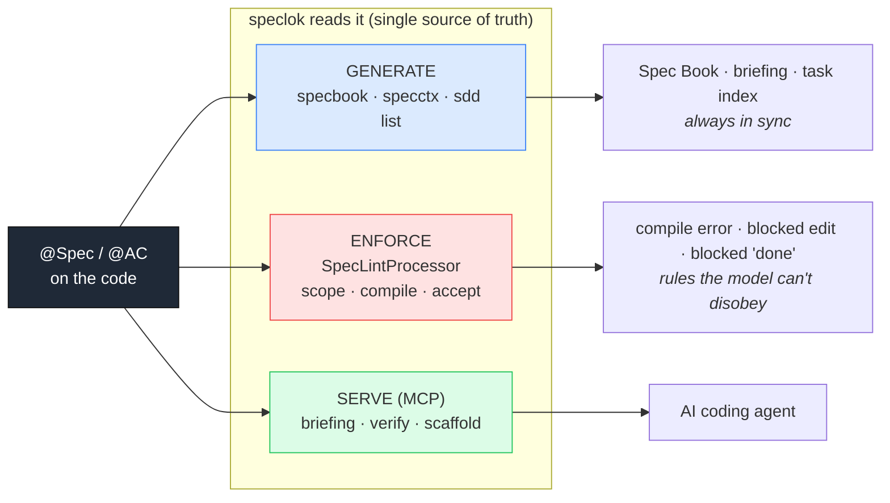
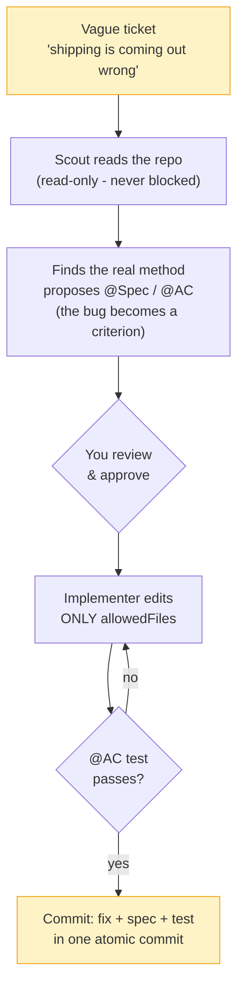

<p align="center">
  <picture>
    <source media="(prefers-color-scheme: dark)" srcset="docs/wordmark-dark.svg">
    
  </picture>
</p>

<p align="center">
  <strong>spec-as-annotation for Java.</strong> Your spec lives in the code, and the compiler enforces it.<br>
  Just as <code>javac</code> rejects a bad <code>@Override</code>, speclok makes it reject an incomplete <code>@Spec</code>.
</p>

<p align="center">
  
  
  
  
</p>

---

`speclok` is a tiny, dependency-free annotation library and CLI for Java. It turns the *specification*
of a piece of code into an annotation that sits **on the class and method it governs**. From that
single source of truth, speclok:

1. **generates** the documentation, the per-task briefing and the task index,
2. **enforces** the contract at compile time (an incomplete spec is a compile error), and
3. **serves** the whole thing to an AI coding agent through hooks and an MCP server.

No separate spec files. No `.md`/`.yaml` to drift. The spec is versioned with the code, in the
same commit, because it *is* the code.

```java
import speclok.Spec;
import speclok.AC;

@Spec(
    id = "T-200",
    objective = "Shipping must never be negative; free above the free-shipping threshold",
    allowedFiles = {"src/main/java/loja/Frete.java", "src/test/java/loja/FreteSpecTest.java"},
    symbols = {"Frete.calcular"},
    outOfScope = {"change the price table", "change the free-shipping threshold"}
)
public class Frete {

    @AC(id = "AC1", given = "a subtotal of 50", when = "calcular(50) is called", then = "returns a shipping fee >= 0, never negative")
    @AC(id = "AC2", given = "a subtotal of 250", when = "calcular(250) is called", then = "returns 0 (free shipping)")
    public int calcular(int subtotal) { ... }
}
```

Write an incomplete `@Spec` (empty `objective`, no `@AC`, an `@AC` missing `then`) and your IDE
underlines it in **red** - a standard compile error, anchored at the exact line:

```
Frete.java:7: error: spec-lint [T-200]: objective is empty
```

## Who it's for

You have a large, old codebase with little or no documentation. Nobody holds the whole thing in
their head, the rules for what-can-change-where live in people's memory, and letting an AI agent
loose in there is a risk. speclok is for exactly that: it turns the guardrail from tribal knowledge
into a rule the compiler enforces.

- **No docs, and no time to write them.** You do not stop to document the repo. The spec accretes
  where the work happens: each time you touch a method, you annotate *that* method. The hot paths get
  specified over months, with no documentation project - and because the spec is an annotation on the
  code, it cannot silently lie.
- **Guardrails that keep slipping.** "Don't touch billing" lives in an `AGENTS.md`, a wiki, a
  senior's head - and it leaks. Here the boundary is `@Spec(allowedFiles)` + `@Protected`, and the
  edit is blocked at write time, not caught in review.
- **Too big to hold in context.** The agent gets only the slice it needs (the task briefing, over
  MCP) and is pinned to the declared scope, so it does not wander the other 2,000 files. That is the
  one thing the benchmark shows cleanly: 3.3% out-of-scope edits vs 77-100% for every other setup.

It is a seatbelt for an AI agent in a legacy codebase: the spec lives in the code, the compiler
enforces it, and the agent cannot edit where you did not let it. It does not make the agent smarter
(correctness is flat in the benchmark) - it makes it **confinable**.

## Why

Two things usually carry "the spec" for an AI agent, and both leak.

**Prompts leak.** You put the rules in a system prompt, `AGENTS.md`, `CLAUDE.md`, `.cursorrules` -
one file per tool. The model follows them... usually. Nothing enforces them, they balloon, they burn
context, and the bigger they grow the more they get ignored.

**Markdown specs rot.** The real contract ends up scattered across a ticket, a `docs/specs/*.md`, an
ADR, a wiki page - each a separate file to find, read, and keep in sync. The moment the code changes,
the doc does not. Now it lies. Nobody trusts it, so nobody reads it, so nobody updates it - and an
agent led by a stale doc walks into a wall, because the repo is the only real source of truth.

One shipping rule, in a normal repo, lives in all of these at once:

```
AGENTS.md             "shipping is never negative"      (rules for one agent)
.cursorrules          "...and free over 200"            (rules for another)
docs/specs/ship.md    the full rule, last edited months ago
docs/adr/0007.md      why we chose it
TICKET-1234           where it actually started
Shipping.java         the code - which may or may not match any of the above
```

speclok collapses that to one place: the contract sits on `Shipping.calcular` as `@Spec`/`@AC`, the
compiler checks it, and it ships in the same commit as the code, so it cannot drift. Everything else -
the docs, the agent briefing, the task index - is **generated** from it: one source, N always-in-sync
outputs, instead of N files to hand-maintain. Scope, compilation, and acceptance become rules the
model cannot disobey, and the spec becomes a compile-time contract for humans too.

(It does not replace every doc - architecture notes and rationale still belong in prose. It replaces
the per-symbol contract that used to rot in markdown.)

## Results (measured, not claimed)

A 210-run benchmark - 7 setups, the same Java brownfield tasks, Claude Sonnet 5, hidden tests the
agent never sees - measured how often each setup edits a file **outside the declared scope**.

| setup | out-of-scope edits (95% CI) | correctness | tokens, median |
|---|---|---|---|
| control (bare agent) | 93.3% [78.7-98.2] | ~83% | 313k |
| spec-kit | 100% [88.6-100] | ~80% | 803k |
| openspec | 96.7% [83.3-99.4] | ~83% | 951k |
| SDD best-practice | 80.0% [62.7-90.5] | ~83% | 1040k |
| **speclok** | **3.3% [0.6-16.7]** | **~80%** | **861k** |

**What it buys: scope discipline.** speclok touches an out-of-scope file in 3.3% of runs; every other
setup does so 77-100% of the time, and its confidence interval does not overlap any of them. That is
the one strong, clean effect in the data.

**What it does not buy.** Correctness is flat (~80-83%) across *all* setups - the gates keep the agent
in its lane, they do not make it smarter. And governance costs tokens: ~2.7x the bare agent (though
speclok is cheaper than every governed setup except spec-kit). If your pain is cost or accuracy, this is not the
tool; if it is an agent straying into the wrong file, it is.

Full methods, Wilson 95% intervals, and limitations: [`docs/benchmark.md`](docs/benchmark.md).

### When to use it

- A large or brownfield codebase with areas an agent must **not** touch (billing, auth, migrations).
- An agent running with little supervision (headless, CI, overnight) - the value scales with how far
  out of your sight it runs.
- You want the spec to stay glued to the code instead of rotting in a `.md`.

Skip it if you are supervising every diff by hand, or if your goal is fewer tokens or higher
correctness - the benchmark says it moves neither.

## Quickstart (60 seconds, no build needed)

The prebuilt harness is in [`dist/speclok.jar`](dist/speclok.jar). Point it at the example:

```bash
cd example

# documentation, generated from the annotations
java -jar lib/speclok.jar specbook src/main/java -o SPECBOOK.md

# the task index (tracking) and a per-task agent briefing
java -jar lib/speclok.jar sdd list
java -jar lib/speclok.jar sdd briefing T-200

# the gates: build + the acceptance tests for the criteria
java -jar lib/speclok.jar sdd verify T-200
```

See [`example/`](example/) for a full project - including a **brownfield fix** (`T-312`) that shows
the acceptance gate blocking "done" until the criterion's test passes.

## How it works - three roles

| Role | What it does | Entry points |
|------|--------------|--------------|
| **speclok GENERATES** | docs (spec book), per-task briefing, task index - all derived, always in sync | `specbook`, `specctx`, `sdd list` |
| **speclok ENFORCES** | incomplete spec → compile error; edit outside scope → blocked; "done" without a passing test → blocked | `SpecLintProcessor`, `sdd scope/compile/accept` |
| **The MCP server CREATES/SERVES** | the agent asks for briefings, lints, runs the gates, scaffolds new specs | `sdd mcp` (JSON-RPC over stdio) |



Full write-up with sequence diagrams: [`docs/how-it-works.md`](docs/how-it-works.md).

## The brownfield loop (how you actually adopt it)

You never annotate a legacy codebase up front - you add one `@Spec` per change, as you touch the code.



## The pieces - `src/core/speclok/` (15 files, JDK-only)

| File(s) | Role |
|---------|------|
| `Spec.java`, `AC.java`, `ACs.java` | The annotations - the public API (`@Retention(SOURCE)`). |
| `Protected.java` | `@Protected(tier)` marks a protected area; the scope guard blocks `FORBIDDEN` edits and checkpoints `RESTRICTED` ones. |
| `SpecLintProcessor.java` | **Enforce (compile time):** a standard annotation processor; an incomplete `@Spec` is a `javac` error. |
| `SpecBookApp.java` | **Generate:** the Spec Book (constitution + every spec). |
| `SpecContextApp.java` | **Generate:** the per-task agent briefing + the symbol→`file:line` context-pack. |
| `SddApp.java` | The `sdd` command - one app dispatching every subcommand. |
| `SddHooks.java` | **Enforce (agent time):** the `scope` / `compile` / `accept` hooks. |
| `SddGates.java` | The build + acceptance gates (internal `javac`, or your build tool). |
| `SddChecks.java` | Validators + extensions: `trace` · `scopeci` · `docs` · `garden` · `observe` · `route` · `telemetry`. |
| `SddOps.java` | The operations: `list` · `briefing` · `speclint` · `verify` · `scaffold`. |
| `SddMcp.java` | **Serve:** the MCP server (JSON-RPC 2.0 over stdio, pure Java). |
| `SddCore.java` | Shared helpers: config, `@Spec` discovery, glob, the symbol indexer. |
| `SddJson.java` | A tiny dependency-free JSON parser/serializer. |

## The `sdd` command

One app, many subcommands - `java -jar speclok.jar sdd <cmd>`:

```
hooks:       scope | compile | accept        (read the agent event on stdin; exit 2 blocks)
validators:  trace <TASK> | scopeci [--base B] [TASK...] | docs
extensions:  garden | observe | route <TASK> | telemetry <log|report>
operations:  list | briefing <TASK> | speclint <TASK> | verify <TASK> | scaffold
server:      mcp                             (for .mcp.json)
```

## Using it in your project

1. Put `speclok.jar` on your annotation-processor path (the prebuilt jar is in [`dist/`](dist/); or
   build it with `bash build-sdd.sh`) and **enable annotation processing** in your build/IDE.
2. Annotate the class/method you are changing with `@Spec`/`@AC`.
3. Optional, for an AI agent: run `java -jar speclok.jar sdd init` to write the hooks
   (`.claude/settings.json`), the MCP server (`.mcp.json`) and a sensible `sdd.config.json` in one
   step, then restart the agent. (Or copy them from [`example/`](example/).)

Config lives in a `sdd.config.json` at the project root (see the example). The acceptance gate runs
a self-contained `javac` by default, or your build tool (`mvn test`, `gradle test`) if you set
`buildCommand`/`testCommand`.

**Driving it with an AI agent** - setting up the MCP, creating a spec (by hand or by asking the
agent to scaffold one), the brownfield flow, and the exact prompts to type: see
[`docs/using-with-an-agent.md`](docs/using-with-an-agent.md).

**Not using Claude Code?** The compile-time check, the MCP server, and the `sdd` CLI are
agent-agnostic and run on any OS (Linux/Debian included). Only the live hooks are Claude-Code-specific,
and enforcement degrades gracefully to the compiler and CI. See
[`docs/other-agents.md`](docs/other-agents.md) for OpenCode, Cursor, Aider, and a Debian setup.

**Tuning for agents (benchmark-driven).** The benchmark showed hooks alone are the weak setup;
turning on MCP, scaffold-first, a pre-shipped config, a scope briefing, and `severity=warn` is what
makes it pay off. The how-to is in [`docs/agent-tuning.md`](docs/agent-tuning.md).

**Governance extras (optional).** `sdd init` also writes a short `AGENTS.md` (working agreements). Mark
sensitive code with `@Protected(tier = "FORBIDDEN"|"RESTRICTED")` and the scope guard blocks or
checkpoints edits to it. The four role-separated subagents (spec-writer, planner, implementer,
reviewer) ship in [`example/.claude/agents/`](example/.claude/agents/). These bring a slice of a
separate, heavier governance framework; that full framework (process workflows, an org standard) can
sit on top of speclok rather than inside it.

## Status & roadmap

This is a **prototype**. What works today: the `@Spec`/`@AC` annotations, the compile-time
`SpecLintProcessor`, the `sdd` app (hooks, validators, extensions, ops) and the Java MCP server -
all dependency-free (JDK only), proven end-to-end. Honest open items: a published Maven/Gradle
artifact, and cross-file trace in the processor.

## Contributing

The harness sources live under [`src/core/speclok/`](src/core/speclok/) (15 files, JDK-only). Build
with `bash build-sdd.sh`. See [`CONTRIBUTING.md`](CONTRIBUTING.md).

## License

MIT. See [`LICENSE`](LICENSE).
