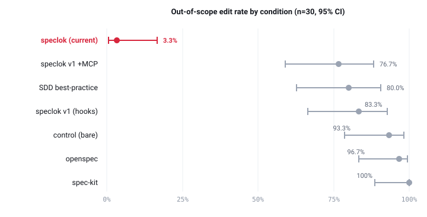

# speclok benchmark - results

Across 210 runs, the current speclok build edits an out-of-scope file in **3.3%** of runs
(95% CI 0.6-16.7); every other setup does so in 77-100%, their confidence intervals non-overlapping
with it. Token cost is higher than an ungoverned agent but below every governed setup except
spec-kit. No setup differs measurably in task correctness.

> Design: 7 conditions x 6 tasks x 5 repetitions = 210 runs. Agent: Claude Sonnet 5, headless.
> All figures and statistics are computed directly from the raw data, committed here:
> [`benchmark-data/results.csv`](benchmark-data/results.csv) (one row per run) and
> [`benchmark-data/summary.csv`](benchmark-data/summary.csv) (per-condition rates).

## Methods

| | |
|---|---|
| **Conditions** | control (bare agent), spec-kit, openspec, SDD best-practice (full-governance framework), and three speclok builds: v1 (hooks), v1 +MCP, and the current build. |
| **Fixture** | one Java brownfield project; 6 tasks (T01-T06); hidden tests the agent never sees. |
| **Primary outcome** | **out-of-scope edit rate** = share of runs that changed a file outside the task's declared allowed set. |
| **Secondary** | correctness (hidden-test pass), input-token cost. |
| **Statistics** | proportions as 95% Wilson score intervals (n=30 per condition, z=1.96); token cost as median [Q1-Q3] input tokens (right-skewed, so not the mean; inclusive quartiles). Every figure is recomputed directly from `results.csv`. |

## Primary outcome - out-of-scope edits

<p align="center"></p>

Dot = point estimate; bar = 95% Wilson interval. The current speclok build's interval (0.6-16.7%)
does not overlap any other condition's, including the other speclok builds. The separation is large
relative to the intervals, so it is not attributable to sampling noise at this n.

## All metrics

| condition | out-of-scope (95% CI) | correctness (95% CI) | tokens, median [Q1-Q3] |
|---|---|---|---|
| control (bare) | 93.3% [78.7-98.2] | 83.3% [66.4-92.7] | 313k [299-386] |
| spec-kit | 100% [88.6-100] | 80.0% [62.7-90.5] | 803k [687-935] |
| openspec | 96.7% [83.3-99.4] | 83.3% [66.4-92.7] | 951k [817-1191] |
| SDD best-practice | 80.0% [62.7-90.5] | 83.3% [66.4-92.7] | 1040k [850-1191] |
| speclok v1 (hooks) | 83.3% [66.4-92.7] | 83.3% [66.4-92.7] | 932k [802-2091] |
| speclok v1 +MCP | 76.7% [59.1-88.2] | 83.3% [66.4-92.7] | 950k [757-1473] |
| **speclok (current)** | **3.3% [0.6-16.7]** | **80.0% [62.7-90.5]** | **861k [724-1075]** |

## Interpretation

- **Scope.** The current build is the only setup whose 95% interval sits well below the rest, and the
  intervals do not overlap - the effect is not sampling noise at this n.
- **Cost.** The governed setups all run 2.5-3.3x the ungoverned baseline's median tokens - the price
  of a spec-driven, gated process. Among them the current speclok build is **second-cheapest** (861k,
  below every governed setup except spec-kit's 803k); the earlier hooks-only build had the widest
  spread (Q3 reaching 2.1M), a pathology since removed.
- **Correctness.** All seven intervals overlap heavily (~80-83%): **no setup measurably changes task
  correctness.** The cost buys scope discipline, not accuracy.

## Limitations

- **Correctness is uninformative here.** Task T05 is solved by none of the seven (the agents fix a
  rounding bug but miss the hidden negative-value test), capping every condition's correctness.
- **Small per-cell n.** 5 repetitions per task; condition-level n=30. Intervals are wide for the
  mid-range conditions - treat their ordering as indistinct.
- **One outcome value had a known artifact.** The current build's 80% correctness reflects a single
  run that broke compile on a malformed `@AC` id; that specific failure is fixed, which would return
  it to the ~83% shared by the rest.
- **Outcome definition.** "out-of-scope" counts any changed file outside the task's allowed set; one
  current-build run's count included a harness state file (an active-task pointer) - a
  near-false-positive, not a code change.
- **Environment deviates from the protocol.** Runs executed on Windows 11 / JDK 21; the pins
  specified Ubuntu 22.04 / JDK 17. Only portability patches were applied.
- **Scope of generalization.** A single agent model and a single fixture family; results may not
  transfer to other models, languages, or task shapes.

## Reproduce it

Every number above comes from [`benchmark-data/results.csv`](benchmark-data/results.csv). The
condition column maps to the labels as: `control`, `spec-kit`, `openspec`, `sdd-eld` (SDD
best-practice), `speclok` (v1 hooks), `speclok-mcp` (v1 +MCP), `speclok-v2` (current). Out-of-scope =
`forbidden_files_changed`; correctness = `hidden_tests_pass`; tokens = `input_tokens`.

```python
import csv, math, statistics as st
rows = list(csv.DictReader(open("docs/benchmark-data/results.csv", encoding="utf-8")))
def wilson(k, n, z=1.96):
    p = k / n; c = (p + z*z/(2*n)) / (1 + z*z/n)
    h = z*math.sqrt(p*(1-p)/n + z*z/(4*n*n)) / (1 + z*z/n)
    return round(p*100,1), round((c-h)*100,1), round((c+h)*100,1)
for cond in ["control","spec-kit","openspec","sdd-eld","speclok","speclok-mcp","speclok-v2"]:
    rs = [r for r in rows if r["condition"] == cond]; n = len(rs)
    k = sum(r["forbidden_files_changed"].strip().lower() == "true" for r in rs)
    tok = sorted(int(r["input_tokens"]) for r in rs)
    q = st.quantiles(tok, n=4, method="inclusive")
    print(cond, wilson(k, n), f"{st.median(tok)/1e3:.0f}k [{q[0]/1e3:.0f}-{q[2]/1e3:.0f}]")
```

---

Wilson score intervals, z=1.96. "speclok (current)" is the published build; the "v1" rows are earlier
iterations; "SDD best-practice" is the full-governance framework layered on top of speclok.
