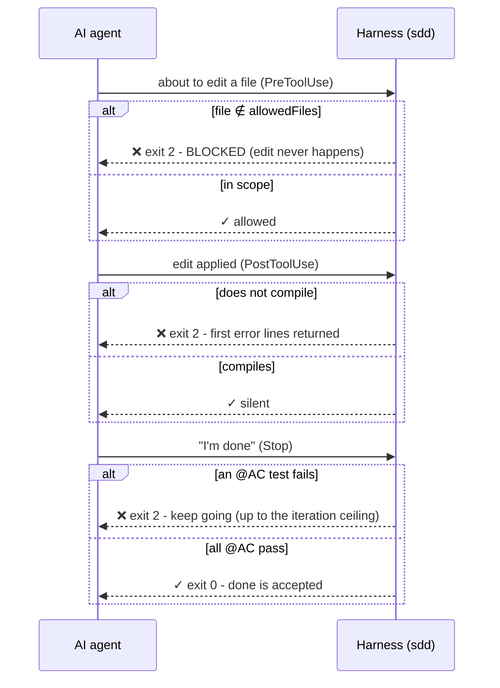
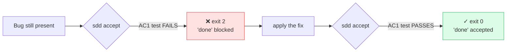

# How it works

The single source of truth is the `@Spec`/`@AC` annotation on the code. Everything else is derived
from it or enforces it. Nothing is stored in a database or a side file - every command re-reads the
annotations from the source tree.

## 1. The spec lives in the code

```java
@Spec(id, objective, allowedFiles, symbols, outOfScope)   // on the class
@AC(id, given, when, then)                                      // on the method, repeatable
```

Both are `@Retention(SOURCE)` - they vanish from the bytecode, exactly like `@Override`. One `@Spec`
per class (it is the *current* contract for that code); the history of previous contracts lives in
git (`git blame` on the annotation).

## 2. speclok GENERATES (always in sync)

- `specbook <root>` → the **Spec Book**: the governing constitution + every task's given/when/then.
- `specctx <TASK>` → the **agent briefing**: objective, scope, a context-pack (each symbol resolved
  to `file:line`), and the acceptance criteria.
- `sdd list` → the task index. `sdd trace <TASK>` → does every `@AC` have a test?

Because these are generated, the docs can never drift from the code.

## 3. speclok ENFORCES (deterministic gates, not prompt rules)

- **Compile time** - `SpecLintProcessor` is a standard annotation processor. An incomplete `@Spec`
  (empty `objective`/`allowedFiles`, no `@AC`, a malformed id, an empty `given/when/then`)
  becomes a `javac` **error**, so it shows up red in the IDE. No agent required.
- **Agent time** - four Claude Code hooks, run as `sdd` subcommands:
  - `sdd arm` (UserPromptSubmit) records which files are already dirty when the turn starts.
  - `sdd scope` (PreToolUse) blocks an edit outside `allowedFiles` before it happens.
  - `sdd compile` (PostToolUse) fails the edit if it does not build.
  - `sdd accept` (Stop) refuses "done" while a file changed outside the scope, an `@AC` has no
    test, or an `@AC` test fails - with an iteration ceiling.

### What the gates cover, and what they do not

The `@Spec` sits in a file the agent may edit, so the scope is **not** read from the working tree.
The enforced scope is the `@Spec` committed at `HEAD` for that file; for a spec that is not committed
yet, it is a snapshot taken the first time the harness sees the task (`.sdd-state/scope-<id>.lock`).
An agent that edits its own `allowedFiles` gets a block that says so. Widening the scope is a human
decision: commit the `@Spec` change (or delete the snapshot) and it takes effect.

| Attempt | Caught by | When |
|---|---|---|
| Edit tool on a file outside the scope | `sdd scope` | before the edit |
| Widening `allowedFiles` / bumping the id, then editing elsewhere | `sdd scope` (baseline scope) | before the edit |
| Edit tool on `.sdd-state/**` (except arming a task from idle) | `sdd scope` | before the edit |
| A shell command (`sed -i`, `echo >`, a generator) writing outside the scope, committed or not | `sdd accept` (`git status` and the commits made this turn, vs the scope) | at "done" |
| Dropping or renaming the test of an `@AC`, or deleting the test file | `sdd accept` | at "done" |
| An `@Spec` / `@Protected` that only appears in a comment or a string | ignored by the parser | - |

An `allowedFiles` edit that is not in force is still sitting in the working tree, and committing it
approves it. So it is surfaced twice: when the agent stops, the Stop hook shows the user a message
naming the spec and the old and new scope; and `sdd scopeci` prints the same for any `allowedFiles`
change in the diff under review (`--strict-scope` turns that into a failure).

Not covered, by design or by limitation - say so rather than rely on it:

- A shell edit is **detected at "done", not prevented**. The agent is told to revert it.
- The Stop check needs a git work tree; outside one it is skipped (or blocks, with `failClosed`).
- An agent that deliberately attacks the harness from the shell - rewriting `.sdd-state/`, or
  running `git commit` to "approve" its own scope change - is not stopped here. Run `sdd scopeci`
  in CI, where the diff (including any change to `allowedFiles`) is in front of a reviewer.
- Hooks fail open by default, so a harness bug never wedges an interactive session. For unattended
  runs set `"failClosed": true` in `sdd.config.json` (or `SDD_FAIL_CLOSED=1`).

Config keys (all optional, in `sdd.config.json`): `scopeBaseline` (`"head"` | `"worktree"`),
`stopScopeCheck`, `stopScopeIgnore` (globs, default build output), `requireTestPerAC`, `failClosed`.



### The acceptance gate, red → green

A fix ships with its regression test attached: the gate will not let "done" through until the
criterion's test passes.



## 4. The MCP server CREATES/SERVES

`sdd mcp` is a JSON-RPC 2.0 server over stdio (pure Java, no dependencies). It exposes five tools to
an agent: `sdd_list_tasks`, `sdd_briefing`, `sdd_speclint`, `sdd_verify`, and `sdd_scaffold_task`
(which generates a brand-new `@Spec`/`@AC` block plus the test).

## The brownfield loop

You do not annotate a legacy codebase up front. You adopt SDD **per change**:

1. A vague ticket arrives ("shipping is coming out wrong"). A read-only scout greps the repo -
   reads are never blocked - and finds the real method, proposing a `@Spec`/`@AC` (the bug becomes
   a criterion).
2. The spec is applied; the implementer edits only `allowedFiles` (the scope guard is the
   leash in a huge repo).
3. The acceptance gate blocks "done" until the criterion's test passes - so the fix ships with a
   regression test attached.

When a later task changes the same method, you **evolve the one `@Spec`** in place: bump the id,
keep the criteria that still hold (regression), edit the ones that changed, add the new ones. Git
is the version history of the contract.
