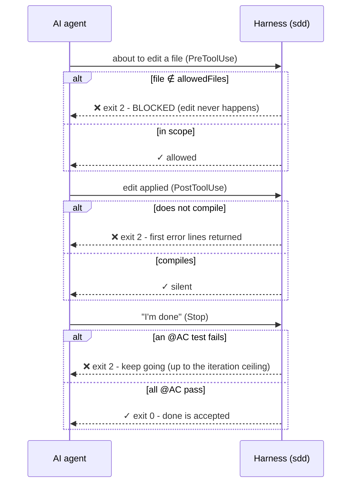
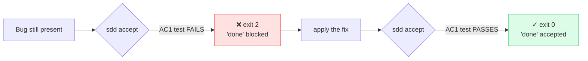

# How it works

The single source of truth is the `@Spec`/`@AC` annotation on the code. Everything else is derived
from it or enforces it. Nothing is stored in a database or a side file - every command re-reads the
annotations from the source tree.

## 1. The spec lives in the code

```java
@Spec(id, objective, allowedFiles, symbols, outOfScope)   // on the class
@AC(id, given, when, then)                                      // on the method, repeatable
```

Both are `@Retention(SOURCE)` - they vanish from the bytecode, exactly like `@Override`. One `@Spec`
per class (it is the *current* contract for that code); the history of previous contracts lives in
git (`git blame` on the annotation).

## 2. speclok GENERATES (always in sync)

- `specbook <root>` → the **Spec Book**: the governing constitution + every task's given/when/then.
- `specctx <TASK>` → the **agent briefing**: objective, scope, a context-pack (each symbol resolved
  to `file:line`), and the acceptance criteria.
- `sdd list` → the task index. `sdd trace <TASK>` → does every `@AC` have a test?

Because these are generated, the docs can never drift from the code.

## 3. speclok ENFORCES (rules the model cannot disobey)

- **Compile time** - `SpecLintProcessor` is a standard annotation processor. An incomplete `@Spec`
  (empty `objective`/`allowedFiles`, no `@AC`, a malformed id, an empty `given/when/then`)
  becomes a `javac` **error**, so it shows up red in the IDE. No agent required.
- **Agent time** - three Claude Code hooks, run as `sdd` subcommands:
  - `sdd scope` (PreToolUse) blocks an edit outside `allowedFiles` before it happens.
  - `sdd compile` (PostToolUse) fails the edit if it does not build.
  - `sdd accept` (Stop) refuses "done" while any `@AC` test fails, with an iteration ceiling.



### The acceptance gate, red → green

A fix ships with its regression test attached: the gate will not let "done" through until the
criterion's test passes.



## 4. The MCP server CREATES/SERVES

`sdd mcp` is a JSON-RPC 2.0 server over stdio (pure Java, no dependencies). It exposes five tools to
an agent: `sdd_list_tasks`, `sdd_briefing`, `sdd_speclint`, `sdd_verify`, and `sdd_scaffold_task`
(which generates a brand-new `@Spec`/`@AC` block plus the test).

## The brownfield loop

You do not annotate a legacy codebase up front. You adopt SDD **per change**:

1. A vague ticket arrives ("shipping is coming out wrong"). A read-only scout greps the repo -
   reads are never blocked - and finds the real method, proposing a `@Spec`/`@AC` (the bug becomes
   a criterion).
2. The spec is applied; the implementer edits only `allowedFiles` (the scope guard is the
   leash in a huge repo).
3. The acceptance gate blocks "done" until the criterion's test passes - so the fix ships with a
   regression test attached.

When a later task changes the same method, you **evolve the one `@Spec`** in place: bump the id,
keep the criteria that still hold (regression), edit the ones that changed, add the new ones. Git
is the version history of the contract.
